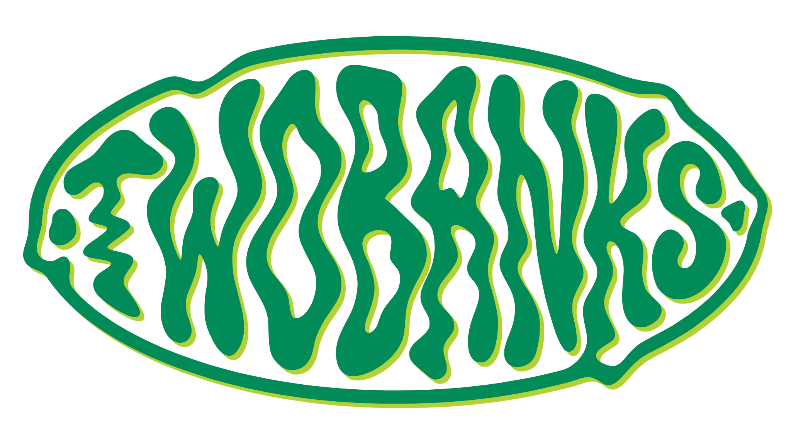

<p align="center">
  
</p>

## 📂 Estrutura do Projeto

```
.
├── .env.local
├── .eslintrc.json
├── .gitignore
├── README.md
├── components.json
├── drizzle.config.ts
├── next.config.ts
├── package.json
├── postcss.config.mjs
├── tailwind.config.ts
├── tsconfig.json
├── public/
│   ├── icons/
│   └── two.svg
└── src/
    ├── actions/        # Server Actions (carteira, blog, kanban, investimentos, etc.)
    ├── app/            # App Router (rotas agrupadas: (auth), (public), admin, api)
    ├── auth.ts         # Configurações do Auth.js (NextAuth)
    ├── components/     # Componentes de interface (UI, Drawers, Forms, Kanban, Charts)
    ├── contexts/       # Contextos globais do React (DrawerContext, VisibilityContext)
    ├── db/             # Schemas do banco de dados e configuração do Drizzle ORM
    ├── lib/            # Funções utilitárias e integrações externas (Strava, Household)
    ├── services/       # Regras de negócio avançadas (recorrências, balanços, faturas)
    └── utils/          # Constantes, tipagens e formatações gerais
```

## 💻 Tecnologias Utilizadas

- **Core & Framework**
  - **Next.js 16.4.0:** Framework React utilizando o paradigma do App Router e Server Actions.
  - **React 19.3.0:** Biblioteca base para a construção das interfaces dinâmicas.
  - **TypeScript:** Tipagem estática rigorosa para maior segurança e previsibilidade do código.

- **Banco de Dados & ORM**
  - **Neon Serverless:** Banco de dados PostgreSQL em nuvem otimizado, operado via driver HTTP (`@neondatabase/serverless`).
  - **Drizzle ORM:** ORM leve e *type-safe* responsável pelas migrações (`drizzle-kit`) e queries.

- **Autenticação & Segurança**
  - **NextAuth.js (Auth.js v5 Beta):** Sistema de sessões de usuário integrado ao banco de dados via `@auth/drizzle-adapter`.
  - **Bcryptjs:** Criptografia para a geração de hashes seguros na funcionalidade de login por *One-Time Password* (OTP).

- **Estilização & Interface**
  - **Tailwind CSS v4:** Motor de estilos nativo, gerenciado via `@tailwindcss/postcss`.
  - **Shadcn UI:** Base de arquitetura de componentes utilizando `class-variance-authority`, `clsx` e `tailwind-merge`.
  - **Lucide React:** Iconografia vetorizada leve e moderna.
  - **Next Themes:** Alternância e persistência de temas (Light/Dark mode).

- **Dados & Visualização Interativa**
  - **Recharts:** Criação de gráficos analíticos (fluxo de caixa, zonas cardíacas, ritmos esportivos).
  - **Mapbox GL & Polyline:** Exibição interativa e decodificação de rotas geográficas (integração Strava).
  - **@dnd-kit:** Motor de *Drag & Drop* responsável pelo funcionamento fluido do Kanban de tarefas.
  - **React Markdown:** Renderização de conteúdo salvo em banco para os artigos do Blog.

- **Comunicações & APIs**
  - **Resend:** Provedor oficial para disparo rápido de e-mails transacionais (envio de códigos OTP).